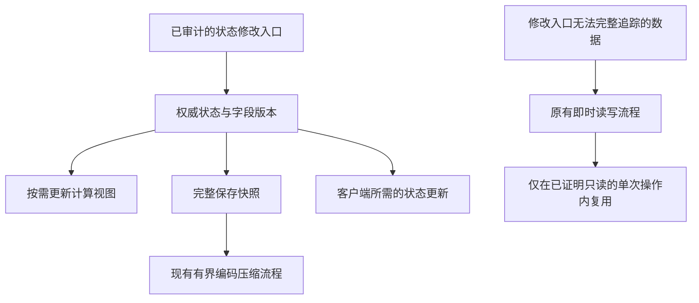

# NBT 优化架构设计

日期：2026-11-06。本文保留原设计；完成后的实际实现与验证见 [NBT 完整实现记录](NBT-COMPLETE-20261106.md)。面向当前 ICE / Forge 1.12.2 / RLCraft Dregora。事实依据见 [前轮调查](NBT-NEXT-STAGE-RESEARCH-20261106.md)。实际实现按模组所有权约束调整：饰品使用标量编码复用，复制保留原生命周期，网络使用原始消息字节差量，没有引入通用 OwnerRevision 或改变原回调。

## 1. 目标与核心决策

目标是降低主线程重复工作、临时对象分配和长帧，不以单个 equals 微基准或 Java 进程内存数字作为成功标准。

采用“按数据所有权适配，按变化更新，按用途输出”的结构：

- 每种状态确定唯一权威来源；不同时维护两份会独立变化的运行态和 NBT。
- 运行时计算读取经过审计的状态视图；保存、兼容接口和网络各自生成所需表示。
- 只有能完整观察写入的对象可以跨操作复用；其他对象保留即时读取。
- 模组适配层负责正确性，共用层只提供小型版本/失效工具，不建设全局 NBT 缓存或新的全局事件总线。



这是分层的事件驱动设计：写操作记录变化，读操作按需更新相关派生值。游戏原有 tick、计时推进和必须执行的模组回调继续工作。

## 2. 接入资格先于缓存算法

| 已证明的能力 | 允许的优化 | 不允许推导出的结论 |
| --- | --- | --- |
| 只知道目标方法和版本 | 原路径、已有 NBT 比较优化 | 不能据此省略序列化回调 |
| 一段调用内数据稳定，相关构造和 getter 可安全复用 | 操作内延迟解析与结果复用 | 不能跨 tick 保留结果 |
| 所有相关写入、加载和对象替换均被拥有者控制 | 字段版本、依赖失效、跨操作视图 | 不能据版本号判断不同对象相等 |
| 快照拥有独立数据，输出边界语义明确 | 编码复用、后台编码、增量网络 | 不能把活 NBT 或 ItemStack 交给后台 |

一个模组可以只有部分路径符合较强条件。类型、方法形状、数据布局、子对象和已知回调均参与资格检查；白名单不能只检查顶层类名。

资格检查尽量发生在产生副作用之前。中途执行了回调或写入后，不能因失败而从头执行原方法，否则会重复伤害、扣费或装备事件。原异常应保持传播；只读且可证明幂等的局部步骤才能重试。

## 3. 第一层：操作内复用，先消除重复转换

### Lycanites 的最小原型

引入 `EquipmentReadView`，生命周期仅限一次提示信息或属性计算。第一次到达原部件读取位置时才解析，后续合格 getter 读取同一份只读视图。退出时释放，不按 ItemStack 全局缓存，不跨帧保存。

首个目标只覆盖实际 `ItemEquipment` 中经过审计的只读属性路径。优先从主手属性计算试起，再扩展到完整说明；feature 回调、部件 Capability 初始化、异常顺序和可变对象别名是必须核对的合同。没有 Items 时不应为了缓存创建额外的重型结构。

若某个 getter 会修改部件或依赖新对象身份，则该段保持原调用；不能只因“发生在同一个方法内”就认定数据不变。需要隔离时优先保留原分段读取，不通过执行原逻辑后再重放来纠正。

第一版保留 feature 查询、聚合和回调的原顺序，只省略已证明可省的解析。第二版才考虑按 feature 类型建立顺序索引：保留重复项、原顺序和继承匹配语义；依赖玩家、时间或世界状态的计算不能无条件预聚合。小列表可能直接扫描更快，必须测量。

一个具体限制是现有 getFeaturesByType 先执行 feature.isActive，再检查 featureType。若先按类型筛选，会省掉原本执行的 isActive 回调；只有进一步证明这些回调纯净且不影响可观察行为后，才可调整。只读 List 包装也不等于子 ItemStack 不可变。

使用显式上下文参数或方法局部变量。只有无法接入签名时才用线程局部栈，并覆盖嵌套调用、异常退出与原上下文恢复；不得假设一个线程永远只处理一个装备对象。

### 算法收益

令 D(N) 为读取 N 个节点并重建部件的成本，k 为一次计算中的重复读取次数，Q 为仍须执行的实际属性计算成本：

```text
原过程：k × D(N) + Q
操作视图：D(N) + Q + 少量上下文访问
```

这只降低重复解析因子，不代表 Q 也降为常数。本机通常装备、Items 存在、锋利度大于零且正常返回时，说明路径有 15 次读取，主手属性路径有 3 次；15→1、3→1 是有条件的原型目标，尚未证明所有回调满足复用要求。

## 4. 第二层：有所有权的状态才做增量更新

### 状态结构

不为每个 NBT 节点增加监听器。由具体拥有者按业务依赖分成少量字段组，例如魔力、能力开关、槽位、元素属性、计时器、制作信息。每个对象维护：

```text
epoch                    对象这一代的身份；替换/重载时重新建立
revision                 本代单调递增的修改序号
lastChanged[group]       各字段组最后变化的序号
derivedView              有必要时才存在的派生视图
derivedBaseline[group]   该视图已经读取的相关字段版本
```

版本计数只描述同一对象代次内的修改历史。不同对象即使 revision 相同，也必须比较真实内容；卸载、替换、重新读取数据及溢出处理都要重建代次和消费基线。

字段依赖在适配器中静态定义，例如“伤害由部件配置与锋利度决定”。少量派生结果用位掩码或固定数组，不引入每次修改都要遍历的通用依赖图。改动只使相关结果失效；下一次真正需要该结果时再计算。

语言、配置、玩家、世界、注册表和时间也是可能的依赖。不能仅用物品版本缓存完整 tooltip 或最终属性；不能追踪的外部依赖保持原计算，先只缓存解析部分。

### 写入与读取合同

写入必须保留原本的赋值、校验和回调语义。即使赋入相同值，也不能擅自省略原 setter 必须执行的副作用。完成状态变化后，同步登记相关字段版本；getter 不通过整树 hash 来判断变化。

如果外部能长期持有可变 NBT、集合、数组或 Capability 引用，而修改不能被完整观察，该字段组不能启用跨操作缓存。仅在一次 getter 时刷新镜像也不能解决外部持有旧引用的问题。

Trinkets 当前既有普通字段，也会暴露并直接使用物品 NBT。因此第一版仍尊重原有权威来源和立即可见性；不能宣布把全部 NBT 改成“只在保存时生成”。计时器和元素属性可能绕过 mana setter 改变，原 saveToNBT 可能顺带提交这些状态。只有审计完全部相关入口后，才能把写入收缩到部分字段组。

还要保持原先替换整个 xat:Trinket 子树的语义：旧引用可能因此失效，未知子键可能被清除。改成原地写一个字段会改变这两种行为。首个组级原型只能复用可证明不可变的数据，再按原边界形成独立子树；若独立复制抵消了收益，就保留完整 writer，不能靠共享可变标签省分配。

### 每个消费者独立记账

存盘、显示视图、每个网络接收者分别保留自己的基线。一个消费者处理完不能清除其他消费者尚未处理的变化。

```text
consumerNeeds(group) =
    consumer.epoch != owner.epoch
    或 lastChanged[group] > consumer.baseline
```

每次捕获当前 revision=r 的独立快照，只在相应消费者成功接收/提交后推进它的基线到 r。捕获后发生的新修改拥有更大的版本，不会被此次完成吞掉。存盘成功指实际写入流程确认成功，不是仅仅启动了压缩任务。

基线还绑定消费者的数据用途及 schema。只有本次已处理该用途所需的全部变化组，才能推进一个统一基线；若只处理其中一部分，使用分组基线。新增显示/同步字段或更换用途时重新捕获完整必要状态。

字段分组数很少时直接扫描固定数组；只有槽位等集合较大且确有收益时，才引入变更集合。复杂度是修改的字段组和受影响依赖的数量，加上各消费者实际需要输出的数据量。

## 5. 第三层：运行时表示与输出表示分别优化

### Capability 比较与复制

先针对完整掌控的 provider 或拥有者调用点设计专用比较/复制，避免先构建临时 NBT。比较必须等价于原序列化结果，包括字段缺失、标签数值类型、列表顺序、默认值和浮点特殊值，不能只对几个显眼字段执行 Java equals。

当前 Forge 比较会先序列化左侧全部 provider，再序列化右侧全部 provider。未知 provider 可能依赖回调顺序、抛异常或动态改变状态。因此首版不在混合 dispatcher 中随意跳过某些 writer；只有完整调用合同被证明满足纯读取条件的目标才能走专用路径，其他调用使用现有 CapabilityNbtBridge。

独立复制仍需复制可变部分。只有不可变且无可变别名的数据可共享；调用者要求可写 NBT 时仍返回独立对象。编码缓存只有在避免的重复编码明显大于维护、复制与保留内存成本时才引入。

比较与复制分别验证。即使字段比较安全，也不能据此省略复制时原本发生的初始化或反序列化回调。

### Trinkets 同步分两阶段

第一阶段保留现有协议和两次采样时点，分析各次采样内部是否有可等价省略的构造。现有独立 tag 与物品 share tag 并非已证明属于同一个版本，直接合并会改变语义，不能作为透明补丁上线。

第二阶段才建立明确的快照协议：同一次发送捕获一致状态，此后编码仅使用该快照；首次观察、物品替换发送完整必要状态，同代次普通更新发送字段组的最终值。这是双方配套的协议改造，需要独立开关和兼容协商。

建议更新携带实体/槽位定位、跟踪会话与槽位代次、baseRevision、targetRevision、字段组掩码及对应绝对值。客户端只有在对象代次和基线吻合时应用增量，否则请求或等待完整状态；旧会话包不得更新新物品。

动态列表第一版按组替换，不维护无限增长的逐元素操作日志。字段删除要显式表示，不能把“未发送”当作“删除”。计时和数值的序列化精度沿用原语义。

同一发送窗口可合并最后状态，但只有在原协议允许的可观察边界内进行。攻击、扣费、装备回调、音效等事件仍逐个执行。已经发入连接的消息不能在本地当作未发送任意替换。未发送增量合并时必须针对接收者仍持有的基线重新生成掩码，而非仅替换最后一个字段。

慢接收者或对象失效时，丢弃可重建的待发增量并安排一次完整状态；不保留无限历史。默认沿用有序连接，不额外为每个数值设计确认消息；连接失败、重新跟踪或基线不匹配会使该接收者的基线失效。

## 6. 资源和线程边界

操作视图随调用释放；持久视图挂在少量已适配对象上，限定保留内容与最大规模。世界卸载或槽位替换应解除引用。对变动频繁、复用很少的数据，不缓存编码结果。不能每个物品同时保留完整 NBT、完整副本、解析副本和编码副本。

状态修改和快照捕获在原拥有线程完成。后台只接收不可变或独占快照，不读取活 ItemStack、NBT 子树、Capability 或世界对象。若建立独立快照需要全量复制，应把该成本计入收益，不能宣传为零拷贝。

复用现有 ChunkSaveCompressionBridge 的有界队列、取消和提交协调。现有 AutosaveBridge 已分摊自动保存，不能重复增加保存调度器。Forge 完整 NBT 保存事件保持原合同。单个任务特别大时，增加队列或线程不能消除它的快照成本。

出现资源压力时优先丢弃可重建缓存、回退原路径；权威状态、待保存修改和必须发生的事件不可丢。关闭模块前要完成仍未物化的必要状态与提交，随后清理缓存，不能让原路径读取过期镜像。

## 7. 与 ICE 的最小集成

保持现有 adapter → bridge → 模块开关结构，避免创建一套独立框架。

| 拟新增单元 | 职责 | 首版需要 |
| --- | --- | --- |
| LycanitesEquipmentReadAdapter / Bridge | 识别已审计入口，管理操作上下文和原路径回退 | 是 |
| EquipmentReadView | 本次操作所需的只读部件数据 | 是 |
| TrinketsStateAdapter / Bridge | 明确字段组、原读写边界与相关版本 | 入口审计完成后 |
| OwnerRevision | 极小的版本与消费者基线辅助结构 | 两个以上具体消费者需要时再抽取 |
| TrinketsSnapshot / SyncAdapter | 独立快照与双方同步协议 | 后续独立阶段 |

名称是设计建议，尚不存在这些实现。继续使用现有目标字节码核对、独立模块开关和诊断计数。不同优化分别开启，避免一个未知 provider 让所有 NBT 路径一起失效。

## 8. 实施顺序与通过条件

1. 建立有界观测：按入口汇总调用次数、采样耗时、分配和长帧关联；不为了统计再序列化一次。计时器不必覆盖每个很小的 getter。
2. Lycanites 主手属性的只读片段原型，然后扩展说明路径。保持输出、回调顺序和异常行为；验证复制别名、修改即时可见、嵌套操作与未知类型回退。
3. 审计 Trinkets 字段所有权与变化入口；能证明的部分才做组级增量更新，其他部分保持完整写入。首版保留网络协议与采样时点。
4. 用实际热点选择 provider 直接状态比较/复制。测得收益不足时保留较简单实现，不为了统一设计而迁移所有模组。
5. 单独实现新同步协议与必要的跨操作缓存；双方版本协商、首次跟踪、丢失基线、移槽、卸下、重连、存档重载全部验证。

正确性测试应在独立克隆夹具上比较原路径和候选路径的结果与回调轨迹；不能在真实游戏里连续执行两遍有副作用的操作作为对照。随机操作序列包含字段原地修改、保存失败、捕获快照后再次修改、两个观察者不同步消费、相同版本的不同对象以及关闭模块。

性能验收包括局部调用/分配减少，以及同场景实机帧时间 P95/P99、长帧次数、MSPT、分配率与 GC。高速运动、查看装备、饰品变化等场景分别录制，不能把界面局部收益外推到探索世界。缓存内存和待处理队列必须有界，不能通过积压换取较短当前帧。

## 9. 成本模型与停止条件

对能完整追踪修改、且派生计算无外部副作用的对象，若有 R 次读取、U 次相关变化、每次完整解析成本 D，则稳定阶段可以从约 R×D 降为 U×D 加 R 次轻量读取和版本维护。只有 U 明显小于 R，跨操作缓存才可能值得。

如果字段组和输出接口支持局部重算，单次变化成本还可由完整 N 降为受影响子集 Δ；完整兼容接口、存档及新观察者仍可能必须支付 O(N)。不能声称所有 NBT 操作都能变成 O(1)。

本轮最优先的价值是“少做几次相同的工作”，随后才是“每次只做变化的部分”。只有实际录制证明该路径占比足够大，才扩大改造。举例：若某路径占帧 CPU 时间的 10%，消除其中 80% 的工作，总帧 CPU 时间理想下降也仅约 8%，还未计其他瓶颈；不把局部调用次数当作 FPS 承诺。
